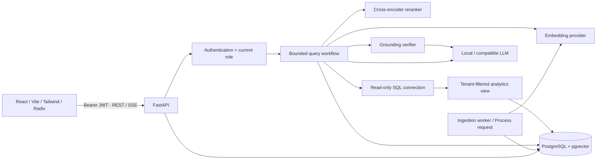

# Architecture

Sai Guru uses a modular monorepo. Browser state holds the current view and provisional answer. Authoritative data is in PostgreSQL, so restarting an API or worker does not erase documents, conversations or job state.

## Persistence

`tenants` own `users`, `documents`, `document_versions`, `document_chunks`, conversations, queries and evaluation runs. Document versions preserve original bytes in `bytea`; there is no writable upload directory. Chunks use a composite `(document_id, tenant_id)` foreign key to prevent mismatched tenant ownership. Vector and lexical indexes support cosine search and PostgreSQL full-text search. Model dimensions are deliberately fixed at 384 in the schema.

Conversations belong to both a tenant and a user. Messages belong to conversations; queries track execution status, costs, latency, source-independent metadata and the request ID. `retrieval_results` preserve candidate scores and source snapshots. `feedback` is unique per query/user. Deleting documents cascades versions/chunks and nulls historical chunk pointers; reading history or traces rechecks the remaining source access before exposing content.

The API's PostgreSQL role owns application state. The SQL analytics tool has **separate credentials** and can only read a security-barrier view filtered by a transaction-local tenant setting. It has no permission on raw employees, users, documents or other tables. Read-only transactions, an audited statement allowlist, row limits and a database statement timeout provide independent restrictions. The backend, not the browser, supplies tenant identifiers.

## Authentication and authorization

Argon2 hashes protect passwords. Signed HS256 JWTs contain a user ID, issuer, audience, issue time and one-hour expiry. Each authenticated request reads the current user's tenant/role from the database rather than trusting stale role claims. The browser stores the short-lived bearer in sessionStorage and clears it on sign-out/401. There is no refresh token, SSO, email delivery or password recovery flow yet. Signing-key rotation invalidates all sessions. User removal invalidates future requests.

EMPLOYEE reads accessible documents and owns conversations/queries. MANAGER adds document management and evaluations. ADMIN also provisions users. Documents carry minimum role levels 0/1/2. Retrieval applies tenant, minimum role, processing completion and active-version filters **in the database before any text reaches a model**. There is no browser-controlled tenant override.

Main application isolation is enforced through query predicates and ownership checks, with composite document foreign keys. It is not a claim of universal PostgreSQL RLS on every table. Supabase's direct Data API access is disabled for these tables by a privilege migration; use the FastAPI routes exclusively. Provision a dedicated project because that migration removes public/anon/authenticated table grants in its public schema.

## Processing and concurrency

Uploads validate file names, suffixes, signatures and sizes before acceptance. A body-size middleware also bounds multipart bytes before parsing. Files progress through UPLOADED, PARSING, CHUNKING, EMBEDDING, INDEXING, COMPLETED or FAILED. Hash-based versioning processes only changed documents. Old chunks are removed when a new version is queued, avoiding stale answers during replacement.

Workers use PostgreSQL session advisory locks for one document at a time. Stages commit visibly, and the lock remains held until completion/failure. A process crash releases the lock and leaves durable state available for another worker. A ten-minute processing timeout prevents indefinite jobs. Local Python thread inference cannot be forcibly killed mid-call; after a timeout it can finish in the background. For hostile untrusted parsers or heavier workloads, move parsing into resource-limited worker processes and use an object store for large files.

Queries are deterministic workflows, bounded at 24 nodes and an overall timeout. Individual retrieval/rerank nodes retry once. Models run off the event loop. SSE uses a bounded queue and sends keepalives; client disconnects cancel query work and record cancellation where the process remains alive. Abrupt machine termination can leave RUNNING query/evaluation records; they remain honest incomplete records and are not counted as completed queries.

## Optional providers and cache

`EmbeddingProvider`, `RerankerProvider`, `Retriever`, `LLMProvider` and `CacheProvider` define replaceable boundaries. Local FastEmbed providers are the defaults. HTTP providers allow model work to run outside a small free API container. The included inference service requires a private key and offers real ONNX and llama.cpp inference.

`InMemoryCache` has capacity and TTL limits, deep-copies values, and provides a scoped key containing tenant, user, role, corpus revision and query. It is supplied but not wired into source-result caching by default: correctness after access changes is more valuable than speculative speed. Redis is not imported or required. Process-local model objects and optional caches are expendable; neither is application state.

## Observability

Each API response receives a generated request ID. Stored query traces record classification, rewritten query, route, retrieval/reranker timing, fusion scores, selected chunks, generation, grounding verdict and final state. Error logs identify the query/request and exception type; the API returns consistent safe errors without credentials or stack traces. Query text and source snapshots live in access-controlled database rows, so retention and database backups should be treated as sensitive when using non-demo data.

Dashboard counts are actual database aggregates. Query metrics are scoped to the signed-in user; document counts reflect their role. A successful query means the pipeline completed without a system error, which includes an honest insufficient-evidence response. Readiness checks the database, extension and migration version, not the availability or quality of an LLM. The UI labels it “Database connected”.
