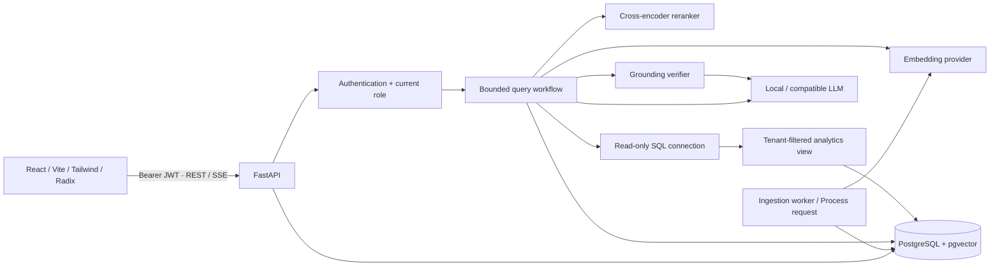

# Architecture

Sai Guru uses a modular monorepo. Browser state holds the current view and provisional answer. Authoritative data is in PostgreSQL, so restarting an API or worker does not erase documents, conversations or job state.

## Persistence

`tenants` own `users`, `documents`, `document_versions`, `document_chunks`, conversations, queries and evaluation runs. Document versions preserve original bytes in `bytea`; there is no writable upload directory. Chunks use a composite `(document_id, tenant_id)` foreign key to prevent mismatched tenant ownership. Vector and lexical indexes support cosine search and PostgreSQL full-text search. Model dimensions are deliberately fixed at 384 in the schema.

Conversations belong to both a tenant and a user. Messages belong to conversations; queries track execution status, costs, latency, source-independent metadata and the request ID. `retrieval_results` preserve candidate scores and source snapshots. `feedback` is unique per query/user. Deleting documents cascades versions/chunks and nulls historical chunk pointers; reading history or traces rechecks the remaining source access before exposing content.

The API's PostgreSQL role owns application state. The SQL analytics tool has **separate credentials** and can only read a security-barrier view filtered by a transaction-local tenant setting. It has no permission on raw employees, users, documents or other tables. Read-only transactions, an audited statement allowlist, row limits and a database statement timeout provide independent restrictions. The backend, not the browser, supplies tenant identifiers.

## Authentication and authorization

Argon2 hashes protect passwords. Signed HS256 JWTs contain a user ID, issuer, audience, issue time and one-hour expiry. Each authenticated request reads the current user's tenant/role from the database rather than trusting stale role claims. The browser stores the short-lived bearer in sessionStorage and clears it on sign-out/401. There is no refresh token, SSO, email delivery or password recovery flow yet. Signing-key rotation invalidates all sessions. User removal invalidates future requests.

EMPLOYEE reads accessible documents and owns conversations/queries. MANAGER adds document management and evaluations. ADMIN also provisions users. Documents carry minimum role levels 0/1/2. Retrieval applies tenant, minimum role, processing completion and active-version filters **in the database before any text reaches a model**. There is no browser-controlled tenant override.

Main application isolation is enforced through query predicates and ownership checks, with composite document foreign keys. It is not a claim of universal PostgreSQL RLS on every table. Supabase's direct Data API access is disabled for these tables by a privilege migration; use the FastAPI routes exclusively. Provision a dedicated project because that migration removes public/anon/authenticated table grants in its public schema.

## Processing and concurrency

Uploads validate file names, suffixes, signatures and sizes before acceptance. A body-size middleware also bounds multipart bytes before parsing. Files progress through UPLOADED, PARSING, CHUNKING, EMBEDDING, INDEXING, COMPLETED or FAILED. Hash-based versioning processes only changed documents. Old chunks are removed when a new version is queued, avoiding stale answers during replacement.

Workers use PostgreSQL session advisory locks for one document at a time. Stages commit visibly, and the lock remains held until completion/failure. A process crash releases the lock and leaves durable state available for another worker. A ten-minute processing timeout prevents indefinite jobs. Local Python thread inference cannot be forcibly killed mid-call; after a timeout it can finish in the background. For hostile untrusted parsers or heavier workloads, move parsing into resource-limited worker processes and use an object store for large files.

Queries are deterministic workflows, bounded at 24 nodes and an overall timeout. Individual retrieval/rerank nodes retry once. Models run off the event loop. SSE uses a bounded queue and sends keepalives; client disconnects cancel query work and record cancellation where the process remains alive. Abrupt machine termination can leave RUNNING query/evaluation records; they remain honest incomplete records and are not counted as completed queries.

## Optional providers and cache

`EmbeddingProvider`, `RerankerProvider`, `Retriever`, `LLMProvider` and `CacheProvider` define replaceable boundaries. Local FastEmbed providers are the defaults. HTTP providers allow model work to run outside a small free API container. The included inference service requires a private key and offers real ONNX and llama.cpp inference.

`InMemoryCache` has capacity and TTL limits, deep-copies values, and provides a scoped key containing tenant, user, role, corpus revision and query. It is supplied but not wired into source-result caching by default: correctness after access changes is more valuable than speculative speed. Redis is not imported or required. Process-local model objects and optional caches are expendable; neither is application state.

## Observability

Each API response receives a generated request ID. Stored query traces record classification, rewritten query, route, retrieval/reranker timing, fusion scores, selected chunks, generation, grounding verdict and final state. Error logs identify the query/request and exception type; the API returns consistent safe errors without credentials or stack traces. Query text and source snapshots live in access-controlled database rows, so retention and database backups should be treated as sensitive when using non-demo data.

Dashboard counts are actual database aggregates. Query metrics are scoped to the signed-in user; document counts reflect their role. A successful query means the pipeline completed without a system error, which includes an honest insufficient-evidence response. Readiness checks the database, extension and migration version, not the availability or quality of an LLM. The UI labels it “Database connected”.

## RAG pipeline

## Ingestion

1. **Upload and validation:** bounded request bytes, plain filenames, seven allowed extensions covering PDF, DOCX, TXT, Markdown, HTML, CSV and JSON. PDF/DOCX signatures and expanded DOCX limits are checked. UTF-8 is required for text formats.
2. **Parsing:** PDF extracts text per page; DOCX extracts heading-associated paragraphs and tables; Markdown recognizes headings; HTML discards scripts/styles/iframes and reads headings/content; CSV keeps named fields per row; JSON keeps records. Empty/scanned text fails clearly. OCR and complex visual/table layout reconstruction are not implemented.
3. **Structure and metadata:** every chunk retains document ID, tenant, version, source, section and any real page number. DOCX pagination is renderer-dependent, so it remains null rather than being guessed.
4. **Chunking:** preserve section/page boundaries, pack sentence units up to 180 words, and split a single oversized sentence by words. There is no global blind character splitter. Caps protect against unusually large extracted content.
5. **Embedding:** local `BAAI/bge-small-en-v1.5` creates genuine 384-dimensional ONNX embeddings in batches of 32. An authenticated compatible HTTP embedding endpoint can replace it.
6. **Indexing:** atomically insert the current chunks, vector values and `to_tsvector('english', heading + text)`. HNSW cosine and GIN full-text indexes are created by migrations.

## Query workflow

The LangGraph `StateGraph` is in `backend/app/agents/workflow.py`, with reusable operation tracing in `observability/trace.py`. Conditional edges select SQL, retrieval, direct answering and general guidance. See [LangGraph and LangSmith](observability.md) for the graph and optional hosted traces. The table below describes operation substeps, not a claim that each is a separate graph node.

| Node | Actual behavior |
|---|---|
| query_classifier | Deterministic DOCUMENT, SQL, HYBRID or DIRECT. Company/document references and common workplace topics use retrieval; other questions use open-ended general LLM knowledge. Numeric policy questions remain DOCUMENT. Routing is heuristic, not semantic classification. |
| conversation_resolver / query_rewriter | In LLM mode, resolve follow-ups into standalone questions using both prior user and assistant turns. Validate the result, then apply deterministic routing; the model cannot choose a SQL tool. A failed or timed-out rewrite uses the deterministic fallback. The actual resolved question is traced. |
| router | Choose the controlled branch; SQL requires a manager/admin. |
| dense_retriever | Embed rewritten query, search current authorized pgvector chunks by cosine distance, top 20. |
| lexical_retriever | Build a websearch OR query from unique word terms, letting PostgreSQL handle English stemming/stopwords; rank matching chunks by `ts_rank_cd`, top 20. |
| rrf_fusion | Merge by chunk ID and sum `1 / (60 + rank)` from each ranking, beginning at rank 1. Missing ranking contributions are zero; results are not concatenated. |
| reranker | Genuine `Xenova/ms-marco-MiniLM-L-6-v2` cross-encoder scores; select six chunks. |
| sql_agent | Inspect analytics-view columns, choose one audited SQL template, validate exact normalized AST membership, execute with read-only credentials/transaction, 3-second statement timeout, 100-row limit. |
| context_builder | Deduplicate text and enforce a conservative 10,000 UTF-8 byte budget. Preserve metadata and stable Source labels. SQL adds one labeled structured result. |
| answer_generator | Stream a compatible LLM draft using only supplied evidence for document/SQL routes. DIRECT is explicitly general knowledge. |
| grounding_checker | Validate source labels, then ask the model whether every factual claim is entailed by its cited evidence. A malformed or negative verdict is unsupported. |
| citation_generator | Return only labels actually cited by the accepted answer, with original source metadata. |
| final_answer | Persist the accepted answer or the exact insufficient-evidence response. |

The context budget is a conservative upper bound for byte-level tokenizers, not a provider-reported token count. Reranker logits, cosine similarity, full-text ranks and RRF scores use different scales; do not compare their absolute magnitudes as probabilities.

Conversation context includes at most 12 messages and 6,000 UTF-8 bytes, with a 2,000-byte per-message cap. Assistant source access is rechecked before reuse; deleted, replaced or no-longer-authorized answers are withheld. Old source labels are removed. History is used for understanding, while company claims must use freshly retrieved evidence and current citations. General-knowledge labels remain visible after reloading a conversation.

## Grounding and streaming

The prompt treats documents/history as untrusted evidence, prohibits obeying document instructions and requires factual claims to cite sources. If evidence is missing or a draft is rejected, return:

> I couldn't find sufficient information in the available knowledge base.

With `GROUNDING_ACTION=regenerate`, one correction attempt and one recheck are allowed; the global timeout still applies. Before model judgment, citation labels must exist and numeric literals in the answer must occur in the cited source text (commas and decimal notation are normalized; citation numbers are excluded). This conservative guard rejects arithmetic or conversions that are not explicitly present in evidence. It does not prove that a number belongs to the correct claim. The model then checks meaning against only the cited evidence. A model judgment is not proof: semantic entailment can still be misjudged, especially by the optional small CPU model.

`POST /api/v1/chat` streams SSE events via authenticated fetch:

- `meta`: persisted query and conversation IDs.
- `status`: actual pipeline stage.
- `draft`: provisional tokens, visibly unverified in the UI.
- `reset`: discard the previous draft before regeneration.
- `final`: accepted answer, citations, grounding, measured latency and message ID.
- `error`: safe failure message/query ID; discard draft.
- `done`: terminal event.

The frontend incrementally decodes UTF-8 and split SSE frames. Malformed JSON and premature EOF are errors. Stopping a request cancels the backend producer and records cancellation. Copy, citations and feedback are attached to final messages. Regenerate submits the preceding user question as a new recorded attempt; prior attempts remain in history.

## Fallbacks

- Dense provider failure: retry once, roll back a failed DB transaction if needed, then attempt lexical retrieval and record degradation.
- Reranker failure: retry once, then return the top fused candidates with unavailable reranker scores.
- LLM failure: surface an error; never silently invent or substitute a generated answer.
- Explicit extractive mode: return exact retrieved source text labeled as search excerpts, without calling an LLM. DIRECT questions explain that an LLM is required.
- No authorized evidence: report the missing evidence; optional general guidance is described below.

With `GENERAL_FALLBACK_ENABLED=true` (the default), missing evidence or an explicit model abstention can trigger a separate LLM call for general background or next steps. Its answer begins with a missing-company-evidence notice, has no document citations, and is marked **General knowledge · not source-verified**. It must not invent company-specific rules, amounts, people or entitlements. A rejected unsupported draft still returns the insufficient-evidence response; it is not relabeled as valid. Set this option to `false` for strict evidence-only abstention. Extractive mode never invokes this fallback. General guidance remains fallible model output.

The debugger records executed nodes, including fallbacks and failures; it does not draw fictional successful stages for a route that skipped them.
