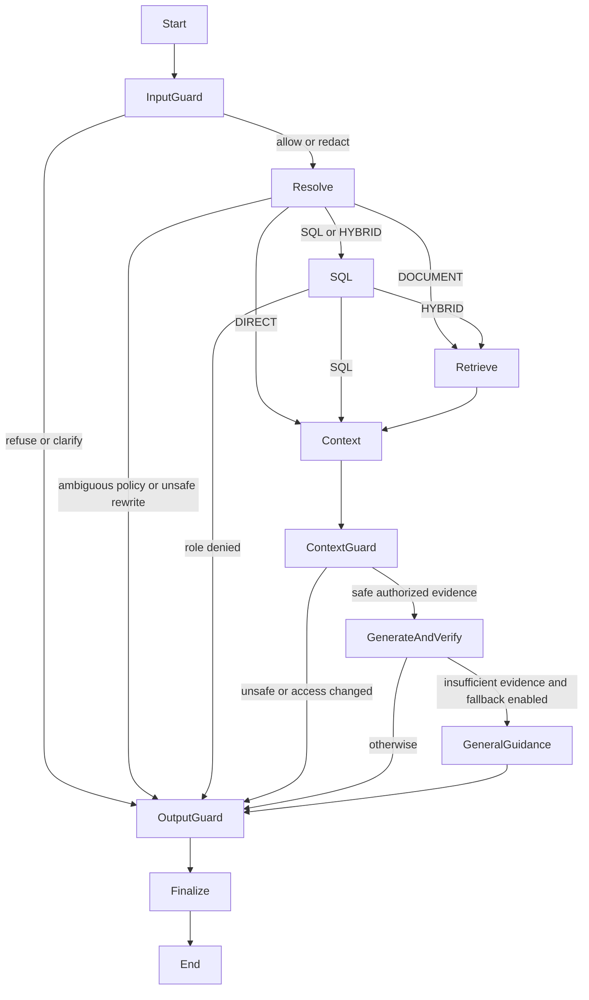

# LangGraph orchestration and LangSmith observability

The backend now runs chat and evaluation queries through a real LangGraph `StateGraph`. LangSmith is optional; an account is not required to run the application. The local integration was connected to LangSmith on 24 October 2026; a synthetic Cloudflare greeting produced a real graph/model trace with hidden inputs and outputs. Production graph trace delivery was verified on 25 October 2026 with inputs and outputs hidden.

## Execution graph



Input, context and output guards are explicit graph nodes alongside resolution, SQL, retrieval, preparation, generation/verification, guidance and finalization. Retrieval screens text and source metadata before reranking. The graph has a 20-step recursion limit, a 24-operation tool budget and at most 12 recorded policy checkpoints. Grounding and output-safety correction share one regeneration attempt. Per-operation and overall timeouts remain in force.

The compiled graph is request-scoped. Database sessions, access scopes, callbacks and model clients stay in closures, outside graph state. There is no shared memory checkpointer. Conversation history continues to come from the existing authorized database-backed history path; this integration does not replace tenant isolation or grant new document access.

SSE events and response schemas remain compatible with the frontend. Existing Retrieval Lab traces are retained.

## Guardrail policy

`backend/app/security/guardrails.py` implements local deterministic checks with `ALLOW`, `REDACT`, `CLARIFY` and `REFUSE` decisions. No additional service or paid model is required.

- `GUARDRAILS_ENABLED=true` enables the policy by default. It does not replace database RLS, role checks or the SQL allowlist, which remain enforced independently.
- `GUARDRAILS_REDACT_IDENTIFIERS=true` masks SSN-shaped identifiers and card-like numbers that pass a Luhn checksum. Ordinary business email addresses are preserved. This is format detection, not comprehensive personal-data classification.
- Supported secret formats include private-key blocks, selected provider-token prefixes, JWT-shaped strings, credential-bearing database URLs and explicit secret assignments. Exact configured model/inference/JWT/LangSmith/seed credentials are also masked when long enough for reliable matching.
- Questions are redacted before persistence in titles and history. History and external model, embedding and reranking payloads are screened or redacted. Uploaded originals remain private database content; this is not a document-deletion or retroactive data-scrubbing feature.
- Clear requests to override safeguards, impersonate system roles, extract hidden prompts or obtain credentials are refused before provider calls. Normal security education and quoted examples have regression coverage. Heuristics can miss novel encodings or produce false positives; a policy match is not proof of intent.
- Instruction-bearing retrieved chunks are withheld before reranking. Text and source names/sections are inspected. If all retrieved evidence is rejected, generation and general fallback stop. Access to selected sources is rechecked before generation.
- Model tokens remain private. Only a checked final answer is displayed; the frontend ignores legacy draft events too. Sensitive output gets at most one correction attempt, then a fixed refusal. Missing explicit company facts receive deterministic next steps rather than model guesses.
- Guardrail traces contain stage, action, rule IDs and counts, never matched values. Runtime LangSmith inputs and outputs are forced hidden while guardrails are enabled. Policy exceptions surface as safe chat errors; they do not silently authorize an answer.

Retrieval Lab shows decisions separately from execution timings. Final chat events and reloaded assistant messages include the same decision metadata. A privacy notice appears when content was redacted or excluded. Historical runs without these fields remain readable.

This policy does not provide general content moderation, comprehensive DLP, or a guarantee against prompt injection. Test against your own documents before changing thresholds or deploying to a different domain. See [measured checks](evidence/README.md#guardrail-verification).

## Enable LangSmith later

Create a LangSmith account and API key. Add the following only to your private backend environment (local `.env`, or hosting environment settings):

```dotenv
LANGSMITH_TRACING=true
LANGSMITH_API_KEY=your-private-key
LANGSMITH_PROJECT=sai-guru
LANGSMITH_ENDPOINT=https://api.smith.langchain.com
LANGSMITH_HIDE_INPUTS=true
LANGSMITH_HIDE_OUTPUTS=true
```

Use the endpoint appropriate for your LangSmith region. Restart the backend, ask a question, and open the tracing project. Expect the `Sai Guru RAG` root, executed graph nodes, operation attempts, and `model_completion` child spans. Provider-reported token usage is attached to model outputs when available; hiding outputs can limit token/cost visibility. No token or cost numbers are invented when providers omit them.

Tracing is explicitly disabled unless configured with both the flag and a key. Missing credentials or client-initialization failure disable hosted tracing without rerunning the request. The SDK exports asynchronously. Hosted delivery, account permissions, quotas and outages still require verification with a real account.

Inputs and outputs are hidden by default through the SDK client. Setting either hide option to `false` allows corresponding questions, history, retrieved document text, SQL results or answers to reach LangSmith. Use only synthetic data for an evaluator demonstration unless the real data is approved for that destination. Hidden inputs/outputs are not a universal scrubber for exception messages or metadata; review tracing settings before using sensitive production data.

## Import the recorded before/after evaluations

The importer uses LangSmith's SDK to create a dataset, reference examples, experiment runs and numeric feedback. It preserves recorded scores and answers; it does not rerun inference or relabel old results as LangGraph measurements. It works with sanitized evidence exports or raw completed evaluation JSON.

From the repository root, preview locally (no credentials or network needed):

```powershell
.venv/Scripts/python.exe scripts/export_langsmith.py docs/evidence/before.json --name sai-guru-before --output .local/deployment/langsmith-before-preview.json
.venv/Scripts/python.exe scripts/export_langsmith.py docs/evidence/after.json --name sai-guru-after --output .local/deployment/langsmith-after-preview.json
```

After reviewing the preview and setting your private API key, append `--upload` to each command. This explicitly sends the selected questions, reference answers, actual answers and numeric metrics. Runtime trace hiding does not hide this intentional evaluation export. No raw retrieval traces, authentication fields or runtime configuration are included.

The same ordered questions and reference answers produce the same dataset name and stable row IDs, enabling side-by-side experiment comparison. Existing experiments with runs are rejected to prevent duplicate imports; an empty project can be resumed only when its source run ID matches. inspect the workspace before retrying after an ambiguous response. Scores are rounded to four decimal places for LangSmith; local originals retain full precision. LangSmith restricts newly posted run timestamps to a recent window. Per-case display timestamps are reconstructed around import time using measured durations; the original run date is preserved in metadata. Both fields are explicitly marked. These are not exact original span timestamps.

The imported labels retain their original meaning: answer relevance is lexical token-set F1; citation correctness is exact document/section matching; faithfulness is the fallible grounding judge's pass rate. The original eight-question results do not measure the new graph's performance. Run a fresh application evaluation after deployment to obtain that evidence.

## Validation and references

Local regression tests cover routing, unchanged streaming/fallback behavior, concurrent request isolation, tracing opt-in/redaction configuration, and import provenance/metric validation. Account-level trace delivery has been verified with a synthetic query. Imported experiment results are recorded historical evidence, not new LangGraph benchmark measurements.

- [LangGraph graph API](https://docs.langchain.com/oss/python/langgraph/graph-api)
- [Programmatic tracing control](https://docs.langchain.com/langsmith/trace-without-env-vars)
- [Trace input/output masking](https://docs.langchain.com/langsmith/mask-inputs-outputs)
- [Import external experiments](https://docs.langchain.com/langsmith/upload-existing-experiments)
