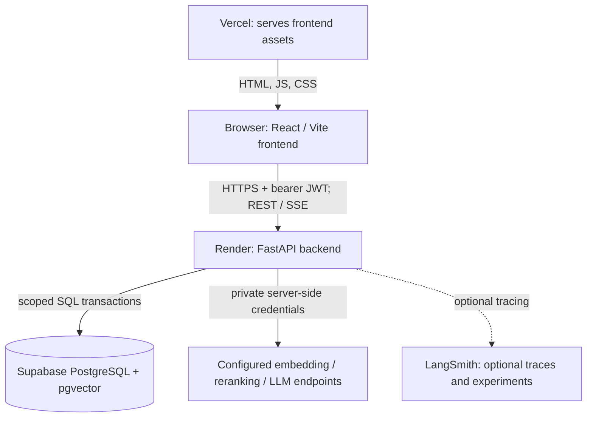
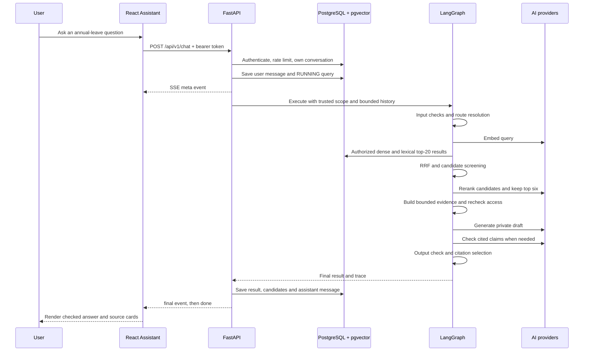
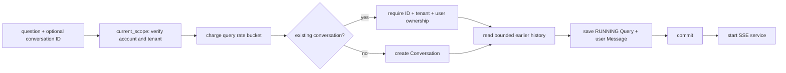
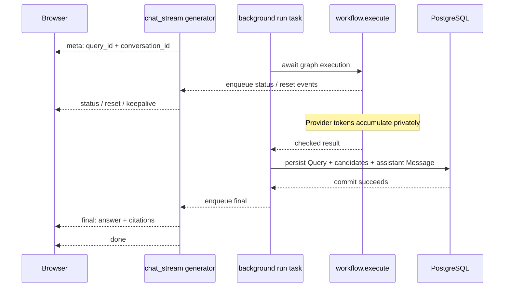
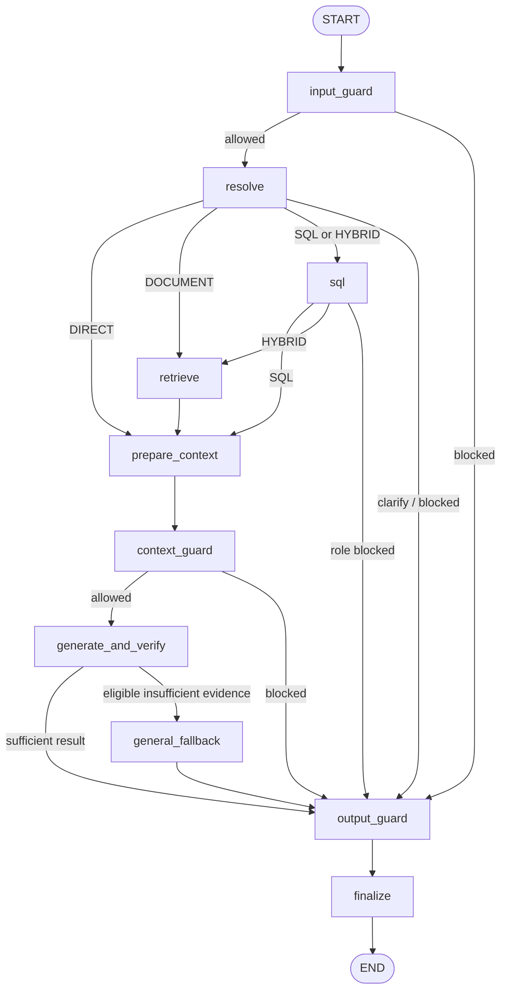
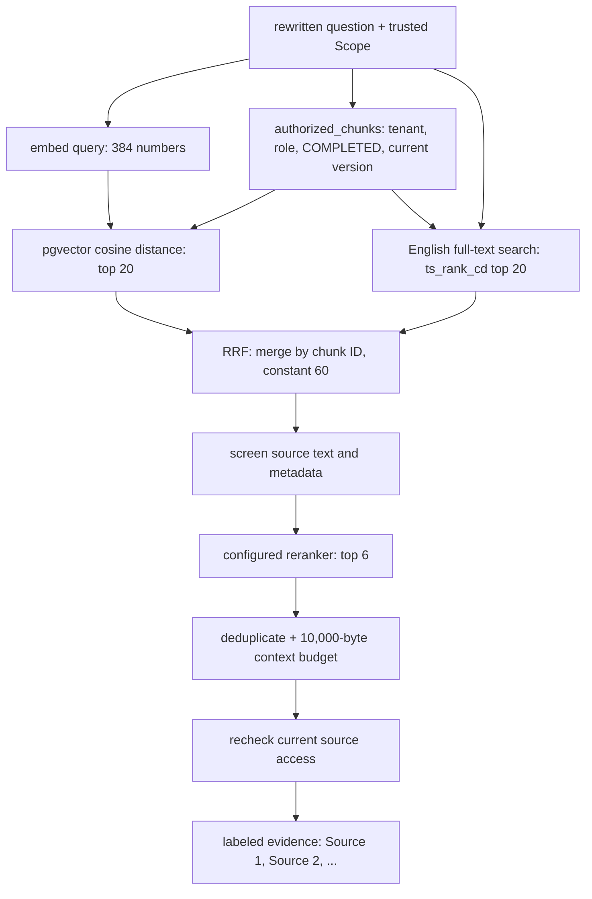
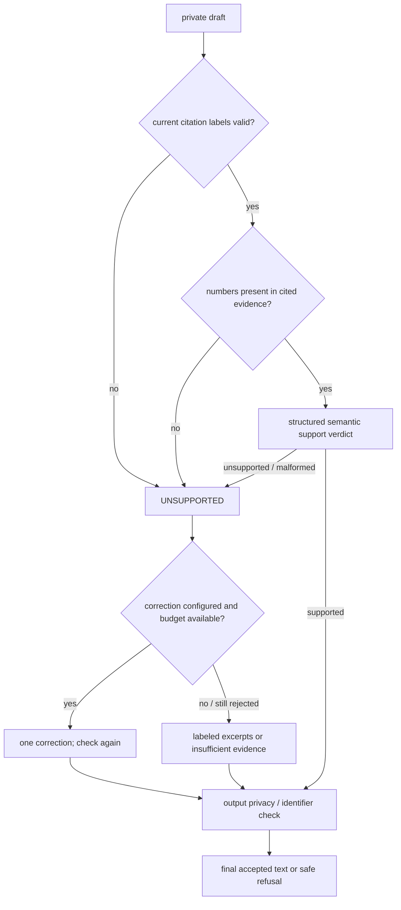
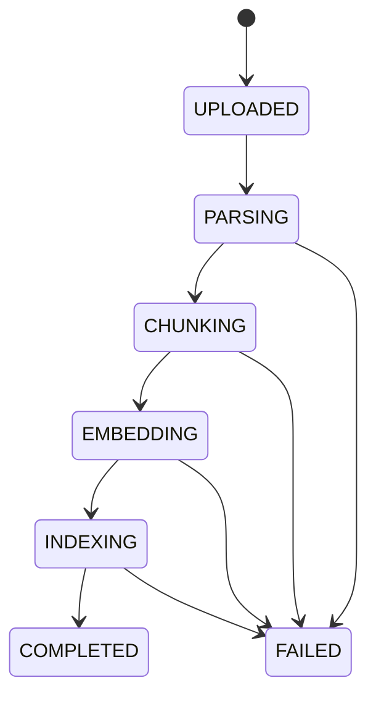
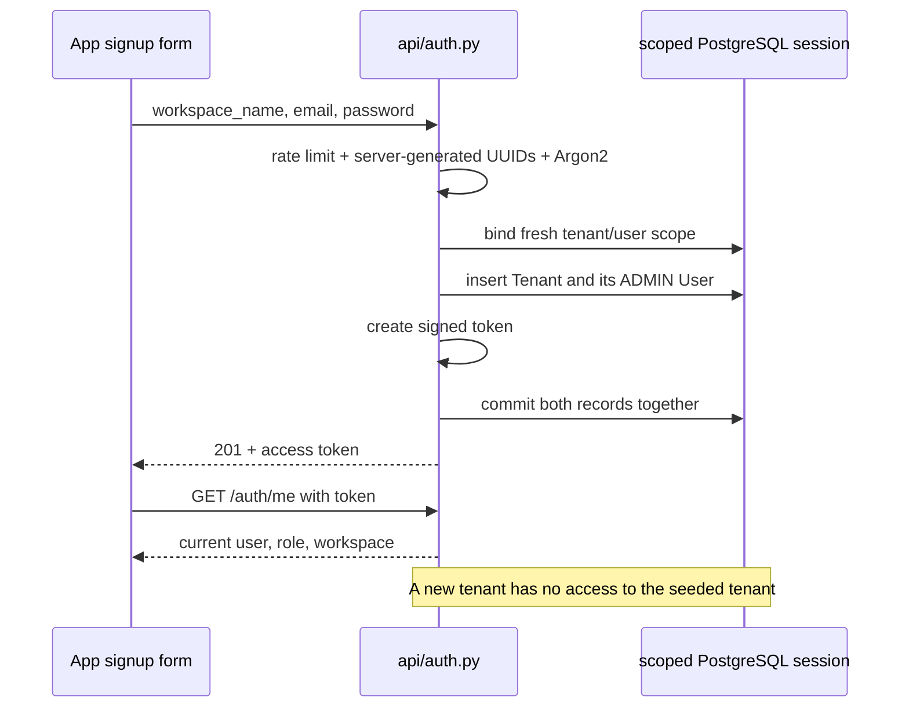
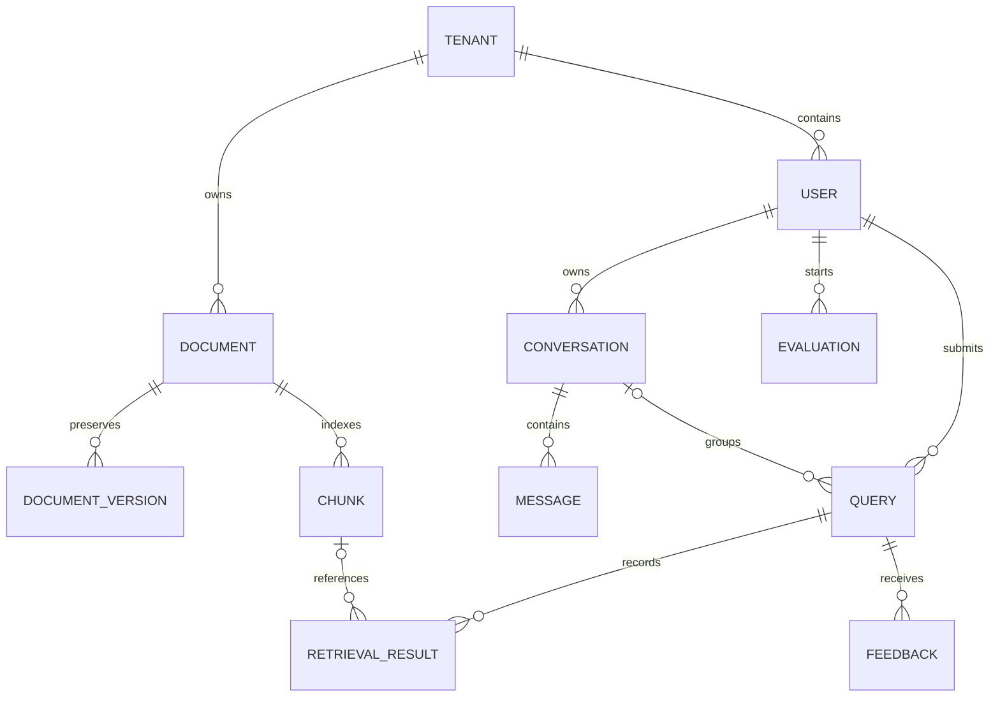

# Sai Guru: follow one question through the code

- **Folder update (2 November 2026):** the numbered source atlas below remains tied to commit `f7f337a`. For the current folder names and execution chain, read [the backend folder map](architecture.md#backend-folder-map).
- **Current core engine:** `backend/app/core/engine.py` replaces `backend/app/agents/workflow.py`. `main.py` remains the FastAPI entry point.
- **Current feature folders:** guardrails and grounding are in `guardrails/`; model providers, history and routing in `llm/`; vectors in `embeddings/`; document splitting in `chunking/`; streaming in `api/streaming.py`. Historical source links describe the earlier snapshot.

- Learning notes prepared on 28 October 2026 from repository commit `f7f337a224cd51a3ca062a7d3d224046db4ea506`.

- These notes describe the implementation at that commit.
- They are a static code walkthrough, not a new live inference run.
- Source line numbers and the accompanying source atlas are tied to that snapshot.
- Private configuration, credentials, runtime records, dependency internals and generated bundles are outside the source atlas.

## The flow to remember

- **You type:** React collects the question.
- **You send:** the browser calls the FastAPI chat endpoint.
- **The backend checks:** identity, tenant, permissions, ownership and limits.
- **LangGraph decides:** general conversation, document evidence, approved SQL, or SQL plus documents.
- **Retrieval searches:** meaning and keywords, then RRF combines the rankings.
- **The reranker sorts:** the best evidence moves into the model context.
- **The LLM drafts:** the answer is still private.
- **Checks run:** evidence, citations and output guardrails decide what can be released.
- **The backend saves:** the final accepted result becomes durable.
- **You see:** the answer and its available sources arrive through SSE.

## Start here

- Start with the system diagram, then follow one query through the numbered stages.
- Study document ingestion, identity, analytics and evaluation as separate flows.
- Open the file guide to see each file's responsibility, inputs, outputs and dependencies; use the line ledger only when you need statement-level detail.
- A continuation line in a multiline expression does not execute as its own operation; the ledger identifies the surrounding statement.
- Blank lines and closing delimiters have no separate business action.

- Our running question is: **“How many annual leave days do our full-time employees receive?”** The walkthrough assumes the user is already signed in to the seeded SaiTech workspace, and its synthetic Leave Policy has been uploaded and processed.
- A newly registered user starts with an empty private workspace and must upload their own documents before expecting document answers.
- `data/demo/Leave-Policy.md` is synthetic demonstration material, not a real employer's policy.

## The whole app in one picture

- Read this as a deployment map, not execution order.
- Vercel serves the browser application.
- Only the backend connects to the database/model services.
- LangSmith observes configured runs; a chat request does not first ask LangSmith for its answer.

- React components render the workspace and keep temporary interface state in the browser.
- FastAPI receives authenticated HTTP requests and streams checked results.
- PostgreSQL stores durable users, documents, original file bytes, chunks, vectors, conversations and results.
- LangGraph controls the request's processing order and branches.
- The embedding model turns the question into numbers; the lexical retriever searches words.
- RRF combines two ranked lists.
- The reranker judges candidate relevance.
- The language model drafts an answer from selected evidence.
- Grounding and output checks inspect that draft.
- The final assistant message is saved before it is sent to the browser.

- The deployed arrangement uses a Vercel frontend and Render backend with PostgreSQL/pgvector on Supabase.
- Remote model endpoints are configured through private environment variables; this project also contains local provider implementations and a separate inference server.
- LangSmith is optional tracing and experiment reporting.
- It is not the application's source of truth or a required part of answering a question.

- `backend/app/core/config.py::Settings` centralizes configuration through Pydantic Settings.
- Its source defaults are local FastEmbed `BAAI/bge-small-en-v1.5` embeddings (384 dimensions), a local `Xenova/ms-marco-MiniLM-L-6-v2` reranker, and an Ollama-compatible endpoint with `qwen2.5:3b`.
- The recorded remote studies instead used Cloudflare BGE embeddings/reranking and Llama 3.3 70B through private environment overrides.
- A model name in a benchmark is evidence of that run's configuration; it does not prove a deployment's current environment has never changed.
- Settings also bound upload size, query timeout, request rate, origins and trace privacy.
- `lru_cache` reuses settings/provider/model/client instances in several factories; this is separate from caching final chat answers.

### Complete request sequence

## Code concepts you will keep seeing

- **Imports and definitions.** An import makes another module's symbols available.
- A `def`, `async def`, class or React component definition establishes code that can be called later.
- Defining `retrieve()` does not immediately search the database.
- A decorator such as `@router.post("/chat")` registers how that function will be reached.
- `@lru_cache` memoizes a factory result, while `@traceable` wraps a callable with tracing behavior.

- **Async and await.** An `async def` returns a coroutine when called; `await` runs/waits for that operation while allowing the event loop to do other work during supported waits.
- Two consecutive awaits are still sequential.
- Actual concurrent work here includes the background `asyncio.create_task(run())` and the response generator.
- Blocking password hashing/local model inference moves to `asyncio.to_thread`; merely writing `async def` around blocking code would not make the CPU operation nonblocking.

- **Scope and closures.** A Scope is trusted account/workspace information, not an embedding or a database connection.
- The nested workflow nodes close over their request's `db`, `scope`, `provider` and `trace`.
- That is why those resources can be used without putting credentials or connection objects into LangGraph's state dictionary.
- Scope's frozen dataclass prevents reassignment of its fields after construction; it does not by itself enforce database authorization.

- **Query construction versus execution.** `select(Document).where(...)` constructs a SQL expression.
- It does not fetch anything yet.
- `await db.scalar(...)`, `scalars(...)` or `execute(...)` sends the statement through the session.
- `add()` stages an ORM object; `flush()` sends changes and can obtain IDs but does not commit; `commit()` makes the transaction durable; `rollback()` discards that transaction's uncommitted changes.
- An async context manager handles resource lifetime, while explicit transaction calls determine durability.

- **Schemas, types and objects.** Pydantic request models validate actual incoming data.
- TypeScript interfaces and Python `TypedDict` mostly describe intended shapes for tools/type checking; they do not automatically reject arbitrary runtime dictionaries.
- SQLAlchemy mapped classes represent database rows.
- Candidate is a lightweight dataclass used to carry evidence and scores between retrieval stages.
- A dictionary returned by a LangGraph node is a state update, whereas the final endpoint response is an HTTP/SSE message.

- **React and JSX.** JSX describes interface elements and component props.
- It is not a backend template that can authorize a user.
- `useState` retains a component value and a setter schedules rendering.
- `useRef` retains a mutable controller/DOM reference without scheduling a render.
- `useEffect` runs side effects according to dependencies and can return cleanup.
- `onClick={() => ...}` passes a function to run after a click; the body is not executed just because the button was drawn.

- **Generators and events.** `yield` returns one item while preserving a generator's continuation.
- The backend chat generator yields strings in SSE format.
- The provider adapter also yields token events, but those are consumed privately by the workflow.
- They are two different streams.
- The queue bridges the background workflow's permitted progress/final events into the browser-facing generator.

- **Scores, labels and confidence.** Cosine similarity, `ts_rank_cd`, RRF and reranker scores are not interchangeable probabilities.
- A larger score affects ranking within its particular stage.
- Source 1 is a label local to one answer, not a database ID or a 100% confidence badge.
- SUPPORTED means this implementation's checks accepted the cited answer; a model judge accepting it is not the same evidence as an independent human checking it.

- **Configuration and secrets.** Backend settings read runtime environment/private configuration.
- Vite's frontend environment variables are substituted into browser assets at build time, so only public configuration such as the backend URL belongs there.
- No database password, model token or JWT signing secret should appear in the frontend or this learning guide.

## 1. Frontend input and submit handler

- `frontend/src/main.tsx` mounts `App`.
- `App.tsx` owns top-level navigation, the authenticated user, and the sign-in/sign-up modal.
- When the user opens Knowledge Assistant, App renders `frontend/src/pages/Assistant.tsx`.
- The Assistant component keeps conversation IDs, visible messages, the current input, the progress label, errors, and the selected source modal in React state.

- Its `send(text = question)` function is the first important checkpoint.
- It ignores blank text and a second submission while busy.
- It clears the input, marks the request busy and appends the user's message to the screen immediately.
- That local message has a temporary `crypto.randomUUID()` ID; it is not yet the database's message record.
- A new `AbortController` lets Stop or component teardown cancel the fetch.

- Assistant calls `streamChat({question: text, conversation_id: active}, callback, controller.signal)`.
- The question is the actual user text.
- The optional conversation ID means “continue this conversation”; it is not a tenant selector or permission grant.
- The server will independently check ownership.

## 2. Authenticated HTTP request and SSE parser

- `frontend/src/lib/api.ts` holds the API base URL from `VITE_API_URL`, with a localhost development fallback.
- `setToken()` keeps the bearer token in this module and `sessionStorage`.
- The ordinary `api<T>()` helper handles JSON and multipart requests; `streamChat()` handles the streamed chat response separately.

- `streamChat()` performs a JSON POST to `${base}/api/v1/chat`, supplies `Authorization: Bearer <token>`, and attaches the abort signal.
- The browser does not send a role or tenant ID.
- `Content-Type: application/json` explains the body format.
- HTTPS protects the deployed transport; the token itself is a bearer credential and must remain private.

- If the initial HTTP response is an error, the helper reads its safe error message.
- A 401 clears the token and emits a `session-expired` browser event.
- App listens for that event and clears the displayed authenticated user.
- If the HTTP response is successful, the helper obtains a `ReadableStream` reader and starts decoding UTF-8 bytes.

- Network chunks are not equivalent to complete events.
- `SSEParser.feed()` appends text to a buffer, normalizes CRLF, splits only on blank-line frame boundaries and keeps the incomplete tail.
- It extracts `event:` and `data:` fields and parses JSON.
- Keepalive comments contain no data and do not become application events.

## 3. API middleware and request validation

- `backend/app/main.py` creates the FastAPI application, installs middleware and includes the API routers.
- Its lifespan hook calls `require_runtime_role()` before serving requests.
- That database check refuses a superuser, a role allowed to bypass RLS, or the owner of the documents table.
- Normal serving uses the restricted runtime connection; migration-owner credentials belong to provisioning tasks.

- The `request_id` middleware assigns a UUID and adds response security headers.
- CORS controls browser origins, methods and headers.
- `BodyLimitMiddleware` bounds incoming bodies, including multipart uploads, before downstream parsing.
- `CapacityMiddleware` recognizes expensive POSTs, including chat, document operations and evaluation runs.
- It first checks the bearer token signature so anonymous traffic cannot reserve expensive capacity.

- Capacity admission is separate from a user's per-minute allowance.
- The middleware maintains a local active count and acquires one of two PostgreSQL advisory-lock slots.
- The database lock coordinates processes sharing that database, rather than relying only on one Python process's memory.
- The slot remains held until the response—including its SSE stream—closes.
- Cleanup releases the advisory lock and closes or invalidates the connection.
- When busy, the middleware returns HTTP 429 with `Retry-After: 5`.

- The dependency system validates `ChatRequest` from `backend/app/schemas/requests.py`.
- Its question length is bounded and its conversation ID is optional.
- The endpoint also rejects a whitespace-only question.
- Pydantic validation is an input contract, not authentication or retrieval.

## 4. Authentication, current role and tenant scope

- `current_scope()` in `backend/app/security/auth.py` validates the JWT's signature, expiry, issuer and audience.
- It uses the token's user ID to load the current user from the database.
- The stored `token_version` must still match.
- The role and tenant are read from the current database record, not accepted as client-provided role claims.

- The result is a small immutable `Scope` from `security/scope.py`: tenant ID, user ID and role.
- The role maps to access levels EMPLOYEE=0, MANAGER=1, ADMIN=2.
- Other modules receive this trusted scope instead of obtaining tenant IDs from a browser form.

- `backend/app/database/session.py` supplies async SQLAlchemy sessions.
- `bind_scope()` sets transaction-local `app.user_id`, `app.tenant_id` or `app.login_email` variables and remembers them in the session's `info`.
- An `after_begin` listener reapplies those values whenever a new transaction begins.
- This matters because commits and rollbacks end transaction-local settings.

- Migration `0003_tenant_rls.py` enables and forces RLS on the main application tables.
- Most policies compare a row's tenant with `current_setting('app.tenant_id', true)`.
- Child-message/result policies check their parent conversation or query.
- The SELECT-only authentication lookup policy permits the supplied user ID or login email to be found before the full tenant scope exists.
- Explicit application filters and database policies work together.
- The older architecture document's claim that there is no broad application-table RLS is outdated relative to this migration.

## 5. Conversation ownership and initial persistence

- The initial commit records submission, not answer success.
- Ownership is checked before reading history.
- A failure after this point still has a query ID that can be inspected.

- The `chat()` endpoint lives in `backend/app/api/chat.py`.
- It charges the user's database-backed query rate-limit bucket.
- `rate_limit()` hashes the bucket key and atomically increments a `(key, window)` row with PostgreSQL `INSERT ... ON CONFLICT DO UPDATE ... RETURNING`.
- Its commit makes the attempt durable even if later inference fails.
- Expired buckets are pruned.
- Exceeding the configured limit produces HTTP 429.

- The endpoint redacts recognized sensitive formats before saving the question or using it as a conversation title.
- If an existing conversation ID was supplied, `owned_conversation()` requires the correct conversation ID, tenant ID and user ID together.
- Guessing another person's UUID is insufficient.
- Otherwise it creates a new conversation and flushes it to obtain its ID.

- It calls `conversation_history()` before inserting this new user message, so the latest question is not mistaken for an earlier conversation turn.
- Then it creates a `Query`, flushes its ID, adds a user `Message`, and commits.
- At this point the database honestly records that a question was submitted even if the client disconnects or the provider later fails.

- The endpoint returns `StreamingResponse(chat_stream(...))`.
- A query's workflow has not completed merely because the HTTP status is now 200.
- A later error must travel as an SSE error event because the response headers may already have been sent.

## 6. SSE transport and background execution

- This diagram separates the provider stream from the browser stream.
- The browser gets progress while the draft is private.
- `final` follows successful persistence.
- An `error` plus `done` is the terminal failure path; HTTP 200 alone is not chat success.

- `backend/app/services/chat.py` creates an `asyncio.Queue(maxsize=64)`, a `Trace`, and a background task named `run()`.
- `emit()` places progress events in the bounded queue.
- This is backpressure: an indefinitely slow consumer cannot cause an unbounded list of queued events.

- The response generator immediately yields `meta`, containing the saved query and conversation IDs.
- Assistant's callback stores the conversation ID.
- Meanwhile the background task opens a new session with the trusted Scope and wraps execution in the configured overall timeout.
- That task awaits `agents/workflow.py::execute(...)`.

- The outer generator waits for queued events.
- If there is no event for ten seconds, it yields an SSE keepalive comment.
- It checks whether the request disconnected.
- On teardown it cancels and awaits unfinished work.
- The task attempts to persist FAILED or CANCELLED status, trace and elapsed time; that persistence is shielded from the immediate cancellation.
- A process crash can still interrupt bookkeeping, so durable RUNNING records are not automatically evidence of success.

## 7. LangGraph state and execution branches

- These node names match `agents/workflow.py`.
- Provider calls, the grounding correction and output correction happen inside node functions; they are not additional graph-cycle edges.
- HYBRID on this diagram means SQL plus document evidence.
- Dense-plus-lexical retrieval occurs inside `retrieve`, including on the DOCUMENT route.

- `backend/app/agents/workflow.py` is the central orchestration file.
- `WorkflowState` describes the values passed between nodes: rewritten question, route, history, candidates, evidence context, SQL result, draft answer, grounding, block flags and final result.
- The database handle and credentials remain in request-local closures rather than being inserted into graph state.

- `execute()` obtains settings, a Trace and start time, then wraps `llm()` in `TrackedLLM`.
- It defines the node functions, adds them to a request-local `StateGraph`, connects normal and conditional edges, compiles the graph and awaits `ainvoke()`.
- Node functions return partial state updates; they do not each send an HTTP response.

- The normal document execution path is: `input_guard → resolve → retrieve → prepare_context → context_guard → generate_and_verify → output_guard → finalize`.
- An insufficient-evidence result can visit `general_fallback` before the output check.
- A blocked input goes directly to `output_guard`.
- SQL and combined SQL/document questions have their own branches.

- There are three distinct bounds.
- The compiled graph has a recursion limit of 20.
- Trace operations/records have a budget of 24, while guardrail checkpoints have their own budget of 12.
- The chat service also has an overall configured timeout.
- A normal state transition is not interchangeable with a trace record or a provider attempt.

### What the data looks like as it moves

- These are illustrative shapes for the annual-leave question, not values captured from a new live run.
- Angle-bracket identifiers are placeholders.
- The exact ranking and Source label are determined by the actual retrieval result.

| Boundary | Data at that point | Who owns the data / what changes next |
| --- | --- | --- |
| React submit | `{question: "How many annual leave days do our full-time employees receive?", conversation_id?: "<id>"}` | The browser submits text and an optional conversation reference; it cannot choose tenant or role. |
| Authentication | `Scope(tenant_id="<workspace>", user_id="<account>", role="ADMIN")` | The server establishes this from the current user. It is passed separately from untrusted text. |
| Initial database commit | `Query(id="<query>", status="RUNNING")` plus user Message | The submitted question now has a durable record; the answer is still unknown. |
| Resolve node | `rewritten="...annual leave..."`, `route="DOCUMENT"`, bounded history | The graph determines which execution branch is needed. It has not generated the answer. |
| Query embedding | `[0.012, -0.031, ...]` with 384 coordinates | These sample coordinates are placeholders. The vector represents query meaning, not a numerical answer or a database record ID. |
| Retrieved candidates | `Candidate(chunk_id, document_id, text, section, version, dense_score, lexical_score)` | Original source text is paired with identity and independently meaningful component scores. |
| Fused / reranked candidates | The same Candidate identities, now with `rrf_score` and optional `reranker_score` | Rankings change; source wording is not rewritten by RRF/reranking. |
| Evidence context | `[{label:"Source 1", document:"Leave-Policy.md", section:"Annual leave", text:"Full-time ... 24 working days ...", ...}]` | Context packing assigns local labels, deduplicates and checks the byte limit/access. |
| Private draft | A string that may say `24 working days ... [Source 1]` | This is provisional backend text. It is not yet a visible assistant Message. |
| Checking | Citation/numeric checks, semantic verdict, output policy decisions | The code may correct, return excerpts, abstain or refuse rather than accept the original draft. |
| Persisted final result | `Query.status="COMPLETED"`, accepted assistant Message, RetrievalResult rows | Successful commit precedes emitting the browser's final answer event. |
| Browser final event | `{answer, citations, query_id, message_id, grounding, latency_ms, guardrails}` | The UI appends the assistant Message, renders Markdown and opens source records on demand. |
- Keep two separate questions in mind: “What data does this function receive?” and “Does this line just build a value, or does it perform a side effect?” Constructing a SQL statement, adding a React event handler, and defining a graph edge are different from executing SQL, clicking the handler, and invoking the graph.

### Names that are easy to mix up

| Term | Actual responsibility in this repository |
| --- | --- |
| Embedding model | Converts text into the fixed-width numeric vectors used for semantic retrieval. It does not write the final answer. |
| Lexical ranking | Searches matching words with PostgreSQL `ts_rank_cd`. The implementation does not currently use BM25. |
| RRF | Merges dense and lexical ranked lists by positions, not by adding their raw scores. |
| Reranker | Reorders the retrieved candidates for query relevance before evidence packing. |
| LLM generation | Writes a provisional response using current selected evidence or the permitted DIRECT/general path. |
| Grounding verifier | Checks whether the draft's cited evidence supports its claims; this may include a separate model call. |
| LangGraph | Controls the nodes and conditional execution path. |
| LangSmith | Observes configured traces or displays imported experiments; it does not route every user query itself. |
| HYBRID route | Includes SQL analytics and document evidence. |
| Hybrid retrieval | Includes semantic and lexical retrieval inside the retrieve node, even when the route is DOCUMENT. |
| Provider stream | Model token fragments consumed privately inside the backend. |
| Browser SSE stream | Allowed progress/reset/final/error events; accepted answer text arrives with final. |
## 8. Input guardrails, follow-up resolution and routing

- `input_guard()` calls `security/guardrails.py::inspect()`.
- It can allow, redact, clarify or refuse.
- Unicode normalization removes format characters and normalizes width; recognized configured secrets, token formats, database URLs and supported identifiers are redacted.
- Pattern checks reject recognized instruction overrides, credential extraction and role-bypass requests.
- Quoted educational examples have narrow handling so legitimate security questions need not all be rejected.

- These are deterministic checks for supported patterns, not a proof against every language, encoding or possible prompt injection.
- The same module is used at several boundaries because hostile text can arrive through a question, conversation history or retrieved documents.
- Findings store rule IDs rather than copying the secret that matched.

- The resolve node starts with deterministic `fallback_resolution()`.
- With history and LLM generation enabled, it asks `services/conversation.py::resolve_question()` for a standalone question.
- For a follow-up such as “How many can I carry over?”, this may resolve what “many” refers to from the previous annual-leave turn.
- History supplies referents, not permission or authoritative company facts.

- `bounded_history()` retains only user/assistant roles, strips old answer-local `[Source N]` labels and bounds the number and UTF-8 size of messages.
- `ConversationHistory.sources` separately records access dependencies without sending resource metadata as extra chat roles.
- Historical source content is rechecked and replaced when its document was deleted, changed version or became inaccessible.

- `agents/routing.py::classify()` recognizes greetings, a small set of employee-analytics phrases, explicit source/document phrases and workplace terms.
- Our running question contains “our”, “annual leave” and “employees”, so it takes DOCUMENT.
- It does not need the extra source-intent model check.

- For an otherwise DIRECT question that is not a greeting or explicit conversation recall, the newer source-aware check reads an authorized topic catalog: at most 60 document-title/section pairs, with each title/section clipped.
- It filters instruction-bearing metadata, redacts it and asks for JSON selecting only DOCUMENT or DIRECT.
- This prevents implicit company questions from too easily receiving ungrounded general answers.
- A non-quota intent-check failure falls back to evidence retrieval; a confirmed Cloudflare daily-allocation failure stops further inference.

- Two meanings of “hybrid” must be kept distinct.
- The router's HYBRID route means **SQL analytics plus document evidence**.
- Hybrid retrieval means **dense semantic retrieval plus lexical retrieval**.
- A DOCUMENT route already uses hybrid retrieval without running SQL.

## 9. Authorized semantic and lexical retrieval

- There can be at most 40 distinct initial candidates before screening, and fewer after deduplication.
- Six reranked candidates can become fewer context entries if they duplicate text or exceed the byte budget.
- None of these ranking scores is a probability that the answer is correct.

- `retrieval/postgres.py::authorized_chunks(scope)` constructs the common SELECT: both chunk and document tenants must match, document minimum role must permit access, processing must be COMPLETED, and chunk version must match the document's current version.
- The database applies these restrictions before source text is returned to the application or a model.

- `DenseRetriever.retrieve()` sends the question to `services/providers.py::embeddings()`.
- The selected provider returns a 384-dimensional vector.
- The SQL query orders authorized chunk embeddings by cosine distance and returns the top 20, recording similarity as `1 - distance`.
- The schema has a pgvector HNSW cosine index; the actual PostgreSQL plan determines whether an index or a different scan is used for a particular query.

- `LexicalRetriever.retrieve()` extracts up to 80 unique word tokens.
- It creates an English `websearch_to_tsquery` joined with OR, searches the indexed `tsvector`, ranks with `ts_rank_cd`, and returns its top 20.
- This is PostgreSQL cover-density full-text ranking.
- It is **not BM25**.
- The two retrievers can disagree usefully: one finds paraphrased meanings while the other rewards matching terminology.

- Each result becomes a `Candidate` from `retrieval/base.py`.
- It carries the stable chunk/document IDs, original text, document name, section/page/version and optional dense, lexical, fusion and reranker scores.
- These are different score systems with different meanings.

- If the dense provider fails for an ordinary recoverable reason, the workflow rolls back the session transaction and continues with lexical retrieval.
- The session's remembered scope is reapplied on the next transaction.
- A known exhausted Cloudflare account allowance is raised immediately instead of making more requests that cannot succeed.
- A 429 is not immediately retried by Trace.
- Other retriever/reranker failures can receive their configured single retry.

## 10. RRF fusion and reranking

- `retrieval/fusion.py::reciprocal_rank_fusion()` merges candidates by `chunk_id`.
- Within each input ranking a duplicate chunk counts only once.
- Each ranking starts at position 1 and contributes `1 / (60 + rank)` to that chunk.
- Scores are added with equal contributions from the two ranked lists.
- A chunk appearing near the top of both lists gets two contributions.
- An absent chunk gets no contribution from the ranking where it is absent.

- For illustration only: a chunk ranked dense #1 and lexical #3 gets `1/61 + 1/63 ≈ 0.032266`.
- A chunk at dense #2 alone gets `1/62 ≈ 0.016129`.
- The algorithm combines rank positions, so cosine scores and full-text scores do not need to share a numerical scale.
- Ties use chunk ID for deterministic ordering.
- These example ranks are explanatory values, not a measured trace for the running question.

- The workflow screens candidate text and metadata before reranking, withholding recognized instruction-bearing chunks and redacting supported sensitive formats.
- `reranking/providers.py` selects a local cross-encoder, generic remote service or Cloudflare reranker from settings.
- The Cloudflare adapter maps returned context IDs back to candidates, rejects malformed/duplicate/out-of-range IDs and nonfinite scores, and keeps the top six by reranker score.

- Reranking asks “which of these candidates is most relevant to this question?” It does not rewrite source text or guarantee that an eventual answer will be correct.
- If reranking is unavailable, the workflow retains the first six fused candidates and records that degradation.
- A known daily account-limit error stops the request instead.

## 11. Context packing and source-access recheck

- `services/context.py::build_context()` serializes selected candidates, deduplicates identical text after whitespace normalization, and gives accepted chunks answer-local labels such as Source 1.
- It uses a 10,000-byte UTF-8 budget with overhead allowance.
- A chunk that would exceed the remaining budget is skipped rather than silently sliced.
- Consequently top-six candidates do not guarantee six final context entries.

- `evidence_text()` formats each accepted source as a label, document, section and original text.
- SQL results, when present on other routes, are appended separately as a labeled read-only analytics source; they are not included in dense/lexical RRF scoring.

- `context_guard()` calls `services/access.py::sources_visible()` on the selected source dependencies.
- This is a current-access checkpoint before generation.
- It checks tenant, role, document version and COMPLETED status.
- SQL sources require manager-level access.
- If all evidence was rejected as unsafe or current access changed, the graph returns a safe refusal.
- It also redacts the context before passing it onward.

## 12. Private draft generation and provider protocol

- `generate_and_verify()` first checks for narrowly recognized conflicting numerical source claims through `services/conflicts.py`.
- When a conflict is detected, it can quote the conflicting evidence with citations rather than choose an unsupported winner.
- This is a limited heuristic, not a general authority-resolution engine.

- With no context on a document route, it sets the insufficient-evidence response without asking a model to invent a company answer.
- In extractive mode it returns labeled verbatim excerpts and does not claim a semantic generation pass.
- In LLM mode it builds a system instruction plus a user message containing the current evidence and current question.

- For DOCUMENT, the prompt requires factual values and exact supporting labels, forbids invented company rules and tells the model to treat source instructions as untrusted data.
- Old conversation is used to understand the question but is not supplied as authoritative company evidence.
- DIRECT uses a different prompt for greetings, general knowledge or personal conversation recall and labels that answer as not grounded in company documents.

- `services/llm.py::OpenCompatibleLLM.stream()` calls the configured OpenAI-compatible chat-completions endpoint with temperature 0, a 1,000-token output cap and streaming enabled.
- This is a protocol choice, not a claim that the provider is OpenAI.
- The Cloudflare JSON-schema path uses a non-streaming request because that provider's structured-output path requires it.
- Stream handling validates JSON events, completion markers and finish reasons; provider errors or incomplete streams are not accepted as complete answers.
- Cloudflare numeric token fragments, including zero, are preserved as text.

- `TrackedLLM` collects real provider usage reports and attaches optional LangSmith LLM spans.
- It does not fabricate tokens when usage is missing.
- Inside the workflow, all draft token fragments are accumulated in a private Python list and joined into one string.
- **Provider token streaming does not mean unchecked answer text is streamed into the browser.** The UI receives progress statuses while this work happens.

- An illustrative answer could be “Full-time employees receive 24 working days of paid annual leave per calendar year, accruing at two days per completed month [Source 1].” The actual wording and source number depend on the selected evidence.
- The number comes from the synthetic Leave Policy; the code does not hardcode this entitlement in its answer generator.

## 13. Grounding, regeneration and output guardrails

- This is the checking logic, not a new accuracy measurement.
- Explicit insufficient evidence and extractive routes have their own branches described below.
- The graph shares a bounded regeneration opportunity across grounding/output correction, and a semantic model verdict can still be mistaken.

- `services/grounding.py::check_grounding()` first recognizes an explicit insufficient-evidence response.
- It then requires at least one known citation label and refuses labels outside the current context.
- A check rejects answers that use a citation in place of the factual value.
- It removes citation numbers from claim text and compares the answer's numeric literals with the cited source text.
- Unsupported arithmetic or unit conversions are not automatically accepted merely because they sound plausible.

- If those checks pass, a separate model call compares the answer with only its cited evidence and returns a structured supported/reason verdict.
- Malformed output is treated as unsupported.
- This model-based judge uses the configured provider; it is not an independent human review and is not infallible.

- When configured to regenerate, the workflow can make one correction attempt with the verifier's reason and current evidence.
- If the result remains unsupported, the code can return clearly labeled relevant verbatim excerpts or the insufficient-evidence response.
- It does not simply publish the rejected draft.
- The one regeneration budget is shared with sensitive-output correction rather than allowing an unlimited loop.

- `general_fallback()` is used only on the appropriate insufficient-evidence branch.
- Guarded company-specific or source-intent questions receive a fixed message asking for the current policy or its owner, rather than a guessed entitlement.
- Other eligible questions may receive clearly labeled general guidance without fabricated source labels.
- GENERAL_KNOWLEDGE therefore must not be presented as a source-verified company answer.

- `output_guard()` performs the final recognized-secret/identifier checks.
- It may allow, redact, regenerate once or refuse.
- If a regenerated document answer is allowed, grounding is checked again.
- These checkpoints improve defense but do not establish universal resistance to every possible attack.

## 14. Final result, citations and persistence

- `finalize()` extracts the citation labels actually present in the accepted answer and returns only matching context entries as citations.
- It records citation and final-grounding trace entries.
- It aggregates usage only when every recorded call supplied valid nonnegative integer counts for prompt, completion and total tokens.
- Otherwise usage remains unknown.
- Estimated cost uses configured per-million token prices; it is not a billing receipt.

- The returned result includes answer, citations, route, rewritten question, grounding, trace, candidates, elapsed milliseconds, optional token/cost data and guardrail decisions.
- The graph itself does not write the assistant message to the database.

- Back in `services/chat.py::run()`, the service updates the saved Query and marks it COMPLETED.
- `persist_candidates()` checks which chunk IDs still exist and stores candidate snapshots and each separate score in `retrieval_results`; a missing chunk can have a null reference while preserving its snapshot.
- It adds the assistant Message with citations, then commits.
- Only after that successful commit does it enqueue `final`.

- If execution or persistence raises, the task attempts to save FAILED/CANCELLED status, safe exception type, trace and latency.
- `services/provider_errors.py` distinguishes known Cloudflare 3036 daily-allocation and 3040 capacity codes, returns safe user-facing recovery messages and keeps provider response text out of those messages.
- `Trace.run()` records only safe numeric HTTP/provider codes and avoids immediate 429 retries.
- The 3036 free allowance resets at 00:00 UTC; this handling does not increase the provider account's allowance.

## 15. Final SSE event, rendering, sources and feedback

- Assistant's event callback processes `meta`, `status`, `reset`, `final` and `error`.
- A reset updates the progress text while a correction is checked; it does not reveal a discarded draft.
- `final` appends a real assistant Message with the database message ID, answer, citations, query ID, grounding and guardrail decisions.
- `error` displays the safe message and query ID for investigation.

- The stream parser requires `done` and a preceding `final` or `error` terminal event.
- A socket closing early is an error, not a silently successful answer.
- In the browser helper's `finally` block, it cancels/releases the stream reader.
- Assistant clears busy/progress state, refreshes the conversation list and scrolls the message view as messages or progress change.

- `components/AnswerMarkdown.tsx` renders model text while blocking generated image tracking and unsafe protocols/HTML.
- `components/ui.tsx::SourceModal` displays the selected citation's source text and metadata.
- Clicking a source shows the evidence delivered for that answer.
- “Inspect” navigates to `pages/Retrieval.tsx`, which requests the saved trace and displays retrieval stages, candidates, scores and guardrail decisions.
- Copy and feedback are UI actions on the accepted message; `POST /feedback` saves feedback only for the signed-in user's completed query.

## Before you ask: make documents searchable

- Upload and query execution are different flows.
- Retrieval does not parse every original PDF again.
- It reads chunks created by this earlier flow.
- The status diagram summarizes processing failures; the worker also handles overall timeout/crash-recovery cases.

- The Knowledge Library screen is `frontend/src/pages/Documents.tsx`.
- Its upload form sends multipart data through `api()`; that helper deliberately lets the browser set the multipart boundary.
- `backend/app/api/documents.py` requires manager/admin access for upload, replacement, processing and deletion.
- Minimum document role cannot exceed the acting user's role.

- `ingestion/service.py::upload()` validates the file, takes an advisory transaction lock for the tenant+name, hashes bytes with SHA-256 and checks the existing logical document.
- An unchanged completed document can be reused.
- A changed document gets a new version and old chunks are removed before reprocessing so stale content cannot be answered during replacement.
- Original bytes go into `document_versions.content`, not a public upload folder.

- The authenticated process route or `ingestion/worker.py` claims work with advisory locks.
- A background worker needs an explicitly configured tenant scope and shares the two heavy-work slots.
- Document-level locks prevent two workers from processing the same document simultaneously.
- Status transitions are committed as PARSING, CHUNKING, EMBEDDING, INDEXING and COMPLETED.
- A process timeout/error marks the document FAILED with a safe message.
- PostgreSQL locks release when their connection dies; durable stage records support later retry.

- `ingestion/sandbox.py::parse_isolated()` runs parsing in a child process with a timeout and a platform-supported memory bound.
- `parsing.py` validates extensions, names, sizes/signatures and supports text/Markdown, JSON, CSV, HTML, PDF and DOCX extraction.
- It discards script/style/iframe HTML content, preserves useful section/page labels and rejects empty or excessively large extraction.
- Scanned PDFs need OCR, which this code does not implement.

- `chunk_sections()` respects section/page boundaries, packs sentences and splits oversized material by words with a default maximum of 180 words.
- It does not implement an overlapping sliding window.
- The service embeds heading+text in batches of 32 and validates vector count and 384 dimensions.
- It inserts original chunk text, metadata, embedding and English `to_tsvector(heading + text)`.
- The schema's HNSW and GIN indexes then support the two retrievers.
- Marking COMPLETED makes the new version eligible for retrieval.

## Account registration and session lifecycle

- App's Sign up button opens a form for workspace name, email, password and confirmation.
- Password confirmation is checked in the browser; the backend independently validates its own request fields.
- `SignupRequest` forbids extra fields, trims email/workspace and requires a 12–128-character password.
- It does not accept a tenant or role.

- `api/auth.py::signup()` charges a five-attempt-per-IP-per-minute bucket, generates fresh workspace/user UUIDs on the server, hashes the password using Argon2 through `pwdlib`, binds only the fresh scope, inserts the tenant and its ADMIN user in one transaction and creates the token before committing.
- A unique-email failure rolls back both rows.
- A new administrator belongs to the new workspace and gets no access to the seeded workspace.
- Existing teams still add members through their administrator's authenticated user-provisioning route.

- `login()` looks up a normalized email under the SELECT-only authentication policy and checks the Argon2 hash in a thread.
- It uses a dummy hash when the user is missing so the password-verification work is not simply skipped.
- Wrong credentials receive the same 401 message.
- The token contains user ID, token version, issue time, expiry, issuer and audience, signed with HS256.
- A strong private signing secret is required.

- `logout()` increments the database token version, so existing copied tokens for that account fail the next authenticated request even before their one-hour expiry.
- The browser's `setToken("")` removes its sessionStorage copy after successful logout.
- There is no refresh-token, email-verification delivery, SSO or password-reset implementation in this snapshot; account emails are login identifiers, not verified email ownership claims.

## SQL analytics: a separate routing branch

- `agents/sql.py` is an audited SQL-template tool.
- Despite the function name `generate_sql`, it does not ask an LLM to compose arbitrary SQL.
- It selects among headcount, joins-last-month, department counts and monthly joins templates from recognized question phrases.
- `sqlglot` parses and normalizes a single statement and requires an exact match to the template allowlist.

- The SQL engine requires separate read-only credentials, cannot reuse the runtime URL, checks the connection role for unsafe privileges and uses a READ ONLY transaction with a three-second statement timeout.
- The backend supplies transaction-local tenant scope.
- Provisioning creates a tenant-filtered analytics view instead of granting the reader raw-table access.
- The result is bounded to 100 rows and date-like values are serialized to ISO strings.

- Manager/admin access is required in both graph routing and the SQL tool.
- SQL-only routes use the returned structured data as evidence.
- HYBRID routes run SQL, then retrieve documents, then combine both contexts for generation.
- Arbitrary browser SQL is not an API feature.

## Database entities, relationships and migrations

- This is the core relationship map, not every column or tenant foreign key.
- `Message.query_id` is a logical indexed reference in this snapshot, not an enforced Query foreign key.
- Document-version/chunk composite foreign keys additionally require the parent document ID and tenant to agree; the source atlas shows the exact constraints.

- `models/entities.py` describes SQLAlchemy table mappings, relationships through foreign keys, indexes and constraints.
- Tenant is the workspace.
- User stores email, password hash, role and token version.
- Document is the logical current source; DocumentVersion retains version bytes; Chunk retains current searchable pieces.
- Conversation and Query are scoped to tenant/user.
- Message belongs to a conversation.
- RetrievalResult stores scores and a snapshot for a query.
- Feedback is unique per query/user.
- Evaluation stores a run's dataset version/status/results.
- RateLimit stores hashed key/window/count.
- Employee supports the restricted analytics view.

- `migrations/versions/0001_initial.py` applies the initial SQL schema; its SQL file defines tables and indexes.
- `0002_private_api.py` removes direct public/anon/authenticated table grants when those managed roles exist.
- `0003_tenant_rls.py` adds forced application-table RLS.
- `0004_session_revocation.py` adds the token-version counter.
- `migrations/env.py` and `alembic.ini` connect Alembic to settings/metadata.
- A schema file is not rerun for every chat question.

- `database/setup_runtime.py` provisions the non-owner runtime role and restricts employee writes.
- `setup_sql.py` provisions the separate analytics reader and its view.
- These run with migration-owner configuration as explicit provisioning work, not with browser credentials.
- `seed.py` creates the initial workspace/admin only if needed and requires a private strong seed password.
- It does not silently reset an existing user's password.
- `retention.py` removes expired operational records according to its configured policy; it is not invoked once per answer.

## Where LangSmith and evaluation fit

- `observability/trace.py` is the local execution record and timeout/retry boundary.
- `observability/langsmith.py` supplies an optional LangSmith client/context with short client timeout.
- Guardrails force hidden trace inputs/outputs in this configuration path.
- Trace client construction failures degrade tracing; application data remains in PostgreSQL.
- `services/llm.py` supplies model spans and provider-reported usage.
- Source text is not needed in public Notion notes to inspect private runtime traces.

- `api/observability.py` serves readiness, dashboard aggregates and the authorized query-debug view.
- Debug/history reads recheck source visibility so deleted, revised or newly restricted sources are not simply re-exposed from saved snapshots.
- Readiness verifies database/schema availability; it does not prove an LLM quota is currently available.

- `evaluation/service.py` runs configured cases through the workflow and stores evaluation status/results.
- `metrics.py` computes retrieval metrics, token overlap F1 and citation matching; token F1 is not a semantic correctness score.
- `retrieval_benchmark.py` scores section-level rankings and paired retrieval comparisons.
- `answer_benchmark.py` validates written references/review labels and calculates correctness, abstention, follow-up and citation-support aggregates.
- It requires externally supplied per-answer reviews for those answer metrics rather than labeling a model judge as a human.

- `scripts/benchmark_retrieval.py` freezes a corpus snapshot and compares dense, hybrid and hybrid-reranked retrieval.
- `benchmark_answers.py` runs frozen answer cohorts without application-data writes, records failures and requires a distinct run after a failed attempt instead of replacing bad measurements.
- `export_langsmith.py` and `evaluation/langsmith_export.py` import measured results into LangSmith with shared reference identities.
- Imported timelines are reconstructed display records, not a new hosted inference run.

- `scripts/prepare_human_review.py` creates a blinded review packet; its fields stay ungraded until a person supplies ratings.
- `validate_resilience.py` runs bounded injection/load diagnostics and labels provider failures inconclusive.
- Test files assert expected behaviors using fixtures/mock transports or explicitly enabled integration databases.
- A passing mocked test is not a new production accuracy measurement.
- The evidence directory explains the actual earlier datasets, denominators and limits; do not convert its small synthetic studies into universal claims.

## The other frontend files

- `pages/Dashboard.tsx` loads authorized aggregate activity and document/query summaries when signed in.
- `pages/Documents.tsx` manages upload, search, status, processing, preview and deletion actions.
- `pages/Retrieval.tsx` displays a selected saved query's route, trace, candidates and source details.
- `pages/Evaluations.tsx` runs and inspects evaluation records for permitted roles.
- These screens call API endpoints; they do not directly connect to PostgreSQL or contain model API keys.

- `lib/types.ts` defines frontend contracts for users, queries, sources, messages, documents, dashboard and evaluation results.
- TypeScript checks usage during build, but cannot validate arbitrary network JSON by itself.
- Backend response schemas and adapter validation provide separate checks.
- `components/ui.tsx` contains reusable buttons, badges, modal, source details, error/empty/loading states and formatting helpers.
- `styles.css` controls layout, color, typography, responsive breakpoints, focus and motion behavior; its CSS declarations do not implement retrieval or authorization.
- `vite-env.d.ts` declares Vite environment typing.

## Deployment and supporting files

- `frontend/package.json` selects frontend dependencies and dev/test/build/lint commands.
- Vite compiles the React/TypeScript sources; its generated dist files are not handwritten source.
- TypeScript and ESLint configs define type and lint rules.
- Frontend tests use Vitest/jsdom; the browser acceptance spec is separate.
- `frontend/index.html` provides the root mount and module entry.

- `backend/pyproject.toml` defines the Python package, dependency ranges, pytest and Ruff configuration.
- Hashed lockfiles pin actual installation inputs; they are generated dependency manifests rather than hundreds of application functions.
- `backend/Dockerfile` builds the runtime image, installs pinned dependencies and runs as an unprivileged user.
- `render.yaml` describes the free backend service and private environment inputs.
- `frontend/vercel.json` handles frontend hosting/routing where present.
- `docker-compose.yml` supports local service wiring.
- The separate `inference/server.py` exposes embedding/rerank HTTP endpoints for self-hosted inference; Cloudflare deployment uses provider adapters instead of requiring that local service.

- `.env.template` documents configuration names and placeholders.
- `.env` and other private deployment files are intentionally excluded from these notes.
- `scripts/configure_local.py` creates a private local environment without overwriting it; `configure_runtime.py` and test-database scripts help local provisioning.
- `check_repository.py` rejects unwanted assistant/generated artifacts in publishable source.
- `check_secrets.py` compares local configured secret values with publishable files.
- Repository ignore, formatting, secret-scanner, security-scanner and CI files are engineering support, not nodes in the live question graph.

- `services/cache.py` defines a replaceable cache boundary and a scoped key, but the main workflow does not call it.
- Therefore this snapshot must not be described as serving chat answers from an active answer cache.
- Likewise a local inference implementation being present does not mean that the deployed API uses it: private provider settings choose the active adapter.

## Points to remember for your viva

- “A user's question goes from my React Assistant component to a FastAPI SSE endpoint with a JWT.
- The server verifies the current account and tenant, saves the submitted question, and runs a bounded LangGraph workflow.
- It resolves follow-ups, filters sources by tenant, role and version, retrieves both vectors and words, combines rankings with RRF and reranks candidates.
- A byte-bounded set of cited excerpts goes to the LLM.
- The draft stays private while citation, numeric, semantic-grounding and output checks run.
- The backend saves the accepted assistant message and retrieval trace, then sends the final event.
- The browser renders the checked answer with sources.
- PostgreSQL is the durable source of truth, while LangSmith supplies optional tracing and experiment views.”

- The shortest faithful call chain is `Assistant.send → streamChat → FastAPI chat → chat_stream → workflow.execute → retrieve → RRF → rerank → build_context → generate_and_verify → output_guard → finalize → database commit → SSE final → AnswerMarkdown`.

- The file guide explains each selected file's purpose, inputs, outputs and direct import relationships.
- The source atlas adds exact numbered source and a line ledger for statement-level reading.
- Start with the query-chain files before reading tests and presentation styles.
- Return to the stage diagram whenever an isolated bracket or continuation line loses its meaning.
